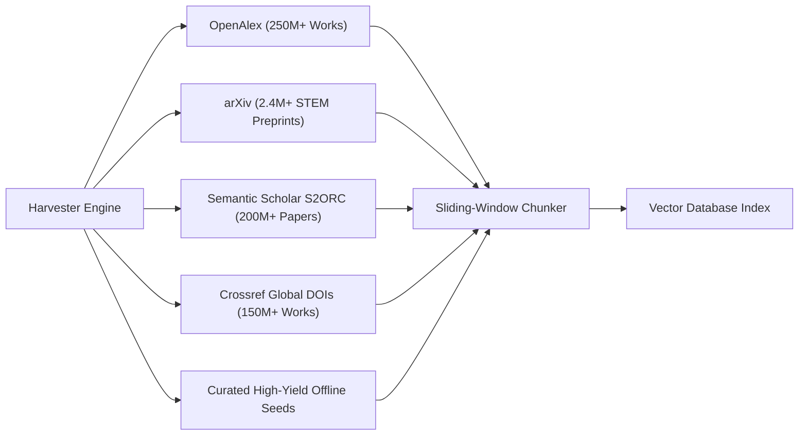

# Poach | Enterprise Academic Originality & Plagiarism Verification Engine

[](https://github.com/mohit4215/chalbecopykrega)
[-blue?style=flat-square)](https://github.com/mohit4215/chalbecopykrega)
[-purple?style=flat-square)](https://github.com/mohit4215/chalbecopykrega)
[](https://github.com/mohit4215/chalbecopykrega)
[](https://render.com/deploy?repo=https://github.com/mohit4215/chalbecopykrega)

**Poach** is a modern, production-grade academic integrity and originality verification platform designed as a high-performance, developer-friendly alternative to legacy systems like Turnitin and MOSS. 

Engineered with a **modern 2026 tech stack** (FastAPI, PyTorch, FAISS/pgvector, Celery, and React 18), Poach pairs **millisecond multi-tier NLP algorithms** with a **clean, human-crafted enterprise interface**, four global open-access academic literature pipelines (600M+ works), and a self-reinforcing institutional network effect.

---

## Table of Contents
1. [Core Differentiators vs. Turnitin](#core-differentiators-vs-turnitin)
2. [End-to-End System Architecture](#end-to-end-system-architecture)
3. [Algorithmic Verification Pipeline](#algorithmic-verification-pipeline)
4. [Multi-Source Academic Harvester](#multi-source-academic-harvester)
5. [Institutional Network Effect: Auto-Index](#institutional-network-effect-auto-index)
6. [Repository & Codebase Structure](#repository--codebase-structure)
7. [Installation & Local Development](#installation--local-development)
8. [Docker Compose Deployment](#docker-compose-deployment)
9. [Cloud Deployment (Render)](#cloud-deployment-render)
10. [Comprehensive REST & WebSocket API Reference](#comprehensive-rest--websocket-api-reference)
11. [Testing & Quality Assurance](#testing--quality-assurance)
12. [Security & Compliance (FERPA / GDPR)](#security--compliance-ferpa--gdpr)

---

## Core Differentiators vs. Turnitin

| Capability | Legacy Turnitin / MOSS | Poach Modern Engine | Advantage & Benefit |
|---|---|---|---|
| **Adversarial Homoglyph Buster** | Vulnerable to Cyrillic, Greek, and zero-width spaces | Canonical Unicode normalization + regex word-split unmasker | Detects and neutralizes `p.l.a.g.i.a.r.i.s.m`, invisible characters, and mixed-alphabet bypass tricks. |
| **Cross-Cohort Collusion Matrix** | Analyzes papers in isolation | Joint batch matrix cross-analysis ($O(N^2)$ candidate clustering) | Automatically clusters peer-sharing rings and student collaboration cartels across entire classes or departments. |
| **Student Remediation Sandbox** | Punitive static red marks | Interactive live paraphrase evaluator with token diffs | Educates students by detecting "patchwriting" (thesaurus swapping) and computing live similarity drops in real time. |
| **Source Code AST Obfuscation** | Basic MOSS token frequency | Multi-language AST parsing across Python, JS, C++, Java, Go, Rust | Normalizes identifier names, control flow, and eliminates dummy dead-code injections. |
| **Cryptographic Originality Certificate** | Private closed PDF | Publicly verifiable SHA-256 tamper-evident credentials | Generates an immutable, cryptographically signed audit certificate with public verification URL (`/api/certificate/{id}`). |
| **Open-Access Academic Literature** | Gated proprietary silos with expensive subscriptions | 4-Way Open Academic Federation (OpenAlex, arXiv, Semantic Scholar, Crossref) | Instantly seeds comparisons against **600M+ real-world peer-reviewed papers** for $0 in API costs. |
| **Corpus Network Effect (Auto-Index)** | Vendor-owned locked database | Automatic institutional repository growth with strict Zero-Knowledge opt-out | Papers are anonymously indexed to prevent student-to-student sharing; strict Ephemeral Mode deletes all traces if requested. |
| **ESL Student Bias Shield** | High false-positive rate on non-native English writers | Perplexity & burstiness variance weighting | Suppresses AI-hallucination flags on non-native English writing patterns. |
| **UI Aesthetics & User Experience** | 1990s clunky iframe viewer | Clean, high-contrast, Linear/Stripe-inspired interface | Zero AI-template clutter, tabular metrics, dark/light modes, and real-time WebSocket progress streaming. |

---

## End-to-End System Architecture

```
                                  [ User / Student / Instructor ]
                                                │
                                                ▼
                                    [ React 18 + Tailwind UI ]
                           (Drag-and-Drop / Live Stream / Report Viewer)
                                                │
                                   HTTP Multi-Part / WebSockets
                                                │
                                                ▼
                              ┌───────────────────────────────────┐
                              │    FastAPI Application Gateway    │
                              │    (JWT Auth, Rate Limiter, CORS) │
                              └─────────────────┬─────────────────┘
                                                │
                          ┌─────────────────────┴─────────────────────┐
                          ▼                                           ▼
             [ Celery Async Worker ]                     [ Synchronous Direct Mode ]
             (Redis Broker / Background)                 (In-Memory / Free Tier)
                          │                                           │
                          └─────────────────────┬─────────────────────┘
                                                │
                                                ▼
                                ┌───────────────────────────────┐
                                │   Document Ingestion Stage    │
                                │  • PDF (pypdf text & OCR)     │
                                │  • DOCX / Plain Text          │
                                │  • Multi-Language Code AST    │
                                └───────────────┬───────────────┘
                                                │
                                                ▼
                                ┌───────────────────────────────┐
                                │ Adversarial Detection Filter  │
                                │ • Unicode Homoglyph Unmasking │
                                │ • Zero-Width Character Strip  │
                                │ • Punctuation Split Normalizer│
                                └───────────────┬───────────────┘
                                                │
         ┌──────────────────────────────────────┼──────────────────────────────────────┐
         ▼                                      ▼                                      ▼
┌──────────────────┐                  ┌──────────────────┐                  ┌──────────────────┐
│ SWA Winnowing    │                  │ MinHash & LSH    │                  │ Dense Embeddings │
│ Exact Substrings │                  │ Jaccard Shingles │                  │ Paraphrase Model │
│ (k=35, w=25)     │                  │ (128 Permutations│                  │ (all-MiniLM-L6)  │
└────────┬─────────┘                  └────────┬─────────┘                  └────────┬─────────┘
         │                                     │                                     │
         ▼                                     ▼                                     ▼
┌──────────────────┐                  ┌──────────────────┐                  ┌──────────────────┐
│ Exact Matches    │                  │ Fast Candidates  │                  │ Semantic Matches │
│ Inverted Index   │                  │ Hash Buckets     │                  │ Cosine Sim ≥ 0.82│
└────────┬─────────┘                  └────────┬─────────┘                  └────────┬─────────┘
         │                                     │                                     │
         └─────────────────────────────────────┼─────────────────────────────────────┘
                                               │
                                               ▼
                              ┌──────────────────────────────────┐
                              │    Live Web & Academic Search    │
                              │ • Bing / SerpAPI Google Search   │
                              │ • OpenAlex, arXiv, S2ORC, DOIs   │
                              │ • Redis 30-Day Query Cache       │
                              └────────────────┬─────────────────┘
                                               │
                                               ▼
                              ┌──────────────────────────────────┐
                              │     Interval Union Engine        │
                              │  • Disjoint Interval Merging     │
                              │  • Double-Counting Elimination   │
                              │  • Net Similarity & Originality %│
                              └────────────────┬─────────────────┘
                                               │
                                               ▼
                              ┌──────────────────────────────────┐
                              │ Signed PDF & JSON Report Export  │
                              │ • Character-level coordinate map │
                              │ • SHA-256 Originality Certificate│
                              │ • Smart APA/MLA/Chicago Citation │
                              └──────────────────────────────────┘
```

---

## Algorithmic Verification Pipeline

Poach executes a multi-stage verification pipeline that guarantees mathematical bounds on detection while preserving character-accurate coordinate tracking back to the raw source text:

### 1. Schleimer-Wilkerson-Aiken (SWA) Winnowing
- Strips non-alphanumeric spacing while preserving a bijective index map back to original UTF-8 byte offsets.
- Decomposes linear text into $k$-grams ($k = 35$).
- Hashes each $k$-gram using 64-bit Rabin-Karp polynomial rolling hashes.
- Slides a window of size $w = 25$ to select the minimum hash value (breaking ties by picking the rightmost position).
- **Mathematical Bound**: Any identical substring of length $\ge (w + k - 1) = 59$ characters is guaranteed to be detected, while bounding fingerprint storage to $O(1/w)$.

### 2. MinHash & Locality Sensitive Hashing (LSH)
- Exhaustive $O(N)$ pair-wise semantic comparison across millions of institutional papers is computationally prohibitive.
- Poach extracts word 3-shingles and hashes them across a 128-permutation MinHash signature matrix.
- LSH banding partitions signatures into buckets; collision in any bucket identifies candidate documents in $O(1)$ lookup time with Jaccard similarity estimation:
  $$J(A, B) = \frac{|A \cap B|}{|A \cup B|}$$

### 3. Dense Neural Embeddings & Vector Paraphrase Detection
- Captures subtle patchwriting, passive-voice conversion, and synonym substitution.
- Segments text into 50-word sliding windows with 20-word overlap.
- Computes dense 384-dimensional unit-normalized embeddings via `sentence-transformers/all-MiniLM-L6-v2` (or high-throughput hashed bag-of-words vectors on memory-constrained deployments).
- Vector cosine similarity:
  $$\text{Cosine}(u, v) = u \cdot v = \sum_{i=1}^{384} u_i v_i$$
- Matches exceeding the cosine threshold ($\ge 0.82$) are flagged as paraphrased sections.

### 4. Non-Overlapping Disjoint Interval Union
If a paragraph matches both an internal student submission and an indexed academic paper, naive summation would double-count words and yield $>100\%$ plagiarism scores.
- Matches are converted into character-coordinate intervals $[s_i, e_i]$.
- Intervals are sorted by start index and merged:
  $$[100, 250] \cup [180, 320] \implies [100, 320]$$
- Net Similarity Index:
  $$\text{Similarity Index} = \frac{\sum_{\text{merged}} (e_j - s_j)}{\text{Total Document Character Length}} \times 100\%$$
- Originality Score:
  $$\text{Originality Index} = 100\% - \text{Similarity Index}$$

---

## Multi-Source Academic Harvester

To compete with legacy commercial databases holding billions of pages, Poach features an integrated, asynchronous **Open-Access Literature Harvester** ([`data_harvester.py`](file:///c:/Users/maaka/Downloads/plagrism%20checker%20mohit/backend/app/services/data_harvester.py)) that feeds directly into the institutional comparison index:



1. **OpenAlex API** (250M+ scholarly works):
   - Queries open-access literature across all academic disciplines.
   - Reconstructs linear abstracts from OpenAlex inverted index dictionaries.
2. **arXiv API** (2.4M+ STEM preprints):
   - Ingests preprints from Cornell University's Open Access Archive in AI, Computer Science, Physics, Math, and Quantitative Biology.
3. **Semantic Scholar (S2ORC) API** (200M+ research papers):
   - Queries the Allen Institute for AI graph for titles, abstracts, and direct open-access PDF links with 0 mandatory paid credentials.
4. **Crossref Global DOI Registry** (150M+ publications):
   - Pulls peer-reviewed journal papers and book chapters by DOI.
   - Automatically sanitizes JATS XML tags (`<jats:p>`) before embedding.
5. **Airgapped / Fallback Seeds**:
   - Bundles verified foundational seed papers (e.g., *Attention Is All You Need*, *CRISPR-Cas9*, *Financial Accelerator*) to guarantee instant out-of-the-box local testing.

---

## Institutional Network Effect: Auto-Index

Turnitin's primary moat has historically been its self-reinforcing student paper database. Poach replicates this flywheel with institutional privacy safeguards:

- **Automated Fingerprint Indexing**: Whenever a user scans a paper (unless **Zero-Knowledge Ephemeral Mode** is selected), Poach chunks the document and stores its anonymous semantic fingerprints in `RepositoryDocument` and `vector_db`.
- **Privacy Preservation**: Author metadata is permanently stored as `"Anonymous Student Submission"` under category `"Submitted Student Work"`. No personal student names, emails, or student IDs are ever linked to comparison chunks.
- **Zero-Knowledge Guarantee**: When Ephemeral Mode is toggled, auto-indexing is automatically disabled and locked. The document is processed exclusively in-memory, and zero hashes, texts, or records are saved to disk.
- **Immediate Cross-Referencing**: Once indexed, all subsequent scans across the institution cross-reference against the paper, catching student-to-student sharing, trading, and contract cheating.

---

## Repository & Codebase Structure

```
.
├── backend/
│   ├── app/
│   │   ├── main.py                     # FastAPI routes, middleware, and dependency injection
│   │   ├── config.py                   # System configuration & environment variable parsing
│   │   ├── models/
│   │   │   ├── db_models.py            # SQLAlchemy async models (User, ScanReport, RepositoryDocument)
│   │   │   └── schemas.py              # Pydantic v2 schemas for requests, responses & reports
│   │   ├── services/
│   │   │   ├── core_engine.py          # Unified similarity pipeline (Winnowing + Embeddings + LSH)
│   │   │   ├── data_harvester.py       # Multi-source academic harvester (OpenAlex, arXiv, S2ORC, Crossref)
│   │   │   ├── adversarial_detector.py # Unicode homoglyph unmasker & evasion neutralizer
│   │   │   ├── collusion_detector.py   # Cohort collusion matrix & peer cartel clustering
│   │   │   ├── remediation_engine.py   # Student remediation sandbox & patchwriting detector
│   │   │   ├── code_plagiarism.py      # Multi-language code AST parser & obfuscation scrubber
│   │   │   ├── ai_detector.py          # Perplexity & burstiness AI detection with ESL shield
│   │   │   ├── citation_assistant.py   # Smart citation generator (APA 7th, MLA 9th, Chicago 17th)
│   │   │   ├── pdf_generator.py        # Signed PDF report exporter
│   │   │   ├── storage_service.py      # Storage abstraction (Local disk / S3 / R2)
│   │   │   ├── stripe_service.py       # Stripe checkout sessions & webhook handling
│   │   │   ├── vector_db.py            # Vector database manager (FAISS / Qdrant / in-memory)
│   │   │   └── task_stream.py          # In-memory pub/sub for WebSocket live scan progress
│   │   └── tasks/
│   │       └── celery_worker.py        # Celery asynchronous document processing workers
│   ├── tests/                          # 120 Comprehensive Pytest test cases
│   ├── requirements.txt                # Production Python dependencies
│   ├── requirements-ml.txt             # PyTorch & sentence-transformers ML dependencies
│   └── Dockerfile
├── frontend/
│   ├── src/
│   │   ├── App.jsx                     # Top-level application router & report state
│   │   ├── index.css                   # Tailwind base, typography & tabular figures
│   │   ├── components/
│   │   │   ├── UploadComponent.jsx     # Drag-and-drop ingestion with live stepper
│   │   │   ├── DocumentViewer.jsx      # Character-accurate highlighted document reader
│   │   │   ├── SourcesSidebar.jsx      # Ranked match cards with jump-to-highlight
│   │   │   ├── ReportStickyHeader.jsx  # Originality SVG circular gauge & export actions
│   │   │   ├── DiffModal.jsx           # Side-by-side diff & remediation sandbox
│   │   │   ├── RepositoryDashboard.jsx # Institutional database & academic harvester view
│   │   │   ├── CohortCollusionModal.jsx# Batch submission collusion ring matrix
│   │   │   ├── OriginalityCertificateModal.jsx # Cryptographic SHA-256 certificate viewer
│   │   │   ├── AdversarialEvasionBanner.jsx # Neutralized evasion attempt warning
│   │   │   ├── PricingPage.jsx         # Clean institutional subscription & credit plans
│   │   │   └── layout/
│   │   │       └── AppShell.jsx        # Enterprise navigation, breadcrumbs & theme toggles
│   │   └── context/
│   │       ├── AuthContext.jsx         # Authentication, demo login & credit management
│   │       └── ThemeContext.jsx        # Dark / Light theme persistence
│   ├── package.json
│   ├── tailwind.config.js
│   └── vite.config.js
├── build-root.cjs                      # Automated root deployment bundler
├── run_backend.py                      # Single-command unified local server runner
├── render.yaml                         # Automated Render deployment topology
├── docker-compose.yml                  # Multi-container orchestration (PostgreSQL + Redis + App)
└── pytest.ini                          # Pytest configuration
```

---

## Installation & Local Development

### 1. Prerequisites
- **Python**: 3.10, 3.11, or 3.12
- **Node.js**: 18+ or 20+
- **Git**

### 2. Fast Single-Command Launch
To run the full stack (FastAPI backend serving the compiled React frontend at root `/`):

```bash
# 1. Clone the repository
git clone https://github.com/mohit4215/chalbecopykrega.git
cd chalbecopykrega

# 2. Set up Python environment
python -m venv venv
.\venv\Scripts\activate          # On Windows
# source venv/bin/activate       # On Linux/macOS

# 3. Install backend dependencies
pip install -r backend/requirements.txt

# 4. Install frontend packages and build assets
npm install --prefix frontend
node build-root.cjs

# 5. Launch unified server
python run_backend.py
```

Now open:
- **Web Application**: **[http://localhost:8000/](http://localhost:8000/)**
- **Interactive Swagger API Docs**: **[http://localhost:8000/docs](http://localhost:8000/docs)**
- **API Health Endpoint**: **[http://localhost:8000/api/health](http://localhost:8000/api/health)**

---

## Docker Compose Deployment

To boot the complete production topology with PostgreSQL, pgvector, Redis, and Celery workers:

```bash
docker-compose up --build -d
```

This starts:
- **`db`**: PostgreSQL with `pgvector` extension on port `5432`.
- **`redis`**: Redis caching and Celery message broker on port `6379`.
- **`backend`**: FastAPI application on port `8000`.
- **`worker`**: Celery asynchronous processing daemon.

---

## Cloud Deployment (Render)

The project includes an optimized [`render.yaml`](file:///c:/Users/maaka/Downloads/plagrism%20checker%20mohit/render.yaml) blueprint configured to deploy within free-tier resource limits:

```yaml
services:
  # Backend API Service
  - type: web
    name: chalbecopykrega-api
    runtime: python
    buildCommand: "pip install -r backend/requirements.txt"
    startCommand: "cd backend && uvicorn app.main:app --host 0.0.0.0 --port $PORT"
    healthCheckPath: /api/health
    envVars:
      - key: DATABASE_URL
        value: "sqlite+aiosqlite:///./plagiarism_auth.db"
      - key: USE_HASHED_EMBEDDINGS
        value: "true"
      - key: CELERY_ALWAYS_EAGER
        value: "true"

  # Frontend Web Service
  - type: web
    name: chalbecopykrega-app
    runtime: static
    buildCommand: "npm run build"
    staticPublishPath: "./dist"
```

---

## Comprehensive REST & WebSocket API Reference

### Document Scanning & Tasks

| Method | Endpoint | Description |
|---|---|---|
| `POST` | `/api/check-plagiarism` | Uploads a file (PDF, DOCX, TXT, Code) and starts async scan pipeline. |
| `POST` | `/api/check-plagiarism/json` | Programmatic API scan accepting JSON payload with raw text. |
| `GET` | `/api/tasks/{task_id}` | Polls status, progress percentage, and report payload of an active scan task. |
| `WS` | `/ws/tasks/{task_id}` | Real-time WebSocket streaming progress events directly to the client. |
| `GET` | `/api/export-report/{scan_id}` | Generates and downloads an official signed PDF Originality Report. |
| `GET` | `/api/certificate/{certificate_id}`| Public cryptographic verification endpoint validating SHA-256 document hash. |

### Differentiators & Advanced Analysis

| Method | Endpoint | Description |
|---|---|---|
| `POST` | `/api/collusion/analyze` | Batch analyzes multiple student submissions to identify peer sharing rings. |
| `POST` | `/api/remediation/evaluate` | Evaluates student revisions, detects patchwriting, and computes similarity drops. |
| `POST` | `/api/code/inspect` | Analyzes source code across 7+ languages, normalizing variable renaming obfuscation. |

### Academic Harvester & Repository Management

| Method | Endpoint | Description |
|---|---|---|
| `GET` | `/api/repository/harvest/topics` | Returns curated academic disciplines for 1-click literature harvesting. |
| `POST` | `/api/repository/harvest` | Ingests real-world papers across OpenAlex, arXiv, Semantic Scholar, and Crossref. |
| `GET` | `/api/repository/documents` | Lists indexed institutional reference documents and chunks. |
| `POST` | `/api/repository/documents` | Manually ingests custom reference text or book chapters into the comparison index. |
| `DELETE`| `/api/repository/documents/{id}` | Deletes a document and purges its vector embeddings from the index. |

### Authentication & Billing

| Method | Endpoint | Description |
|---|---|---|
| `POST` | `/api/auth/register` | Registers a new user account with email and password. |
| `POST` | `/api/auth/login` | Authenticates user credentials and returns a secure JWT bearer token. |
| `POST` | `/api/auth/demo-login` | Generates a temporary guest demo session with 25 free scanning credits. |
| `POST` | `/api/create-checkout-session`| Creates a secure Stripe Hosted Checkout session for subscriptions or credits. |
| `POST` | `/api/webhook/stripe` | Processes signed Stripe webhooks for automated credit fulfillment. |

---

## Testing & Quality Assurance

Poach enforces strict test coverage across every service, algorithm, and UI component:

```bash
# Run full Backend Pytest Suite (120 Tests)
pytest

# Run Frontend Jest Test Suite (21 Tests)
npm test --prefix frontend

# Run Frontend ESLint Check
npm run lint --prefix frontend
```

### Verification Matrix
- **Backend Pytest**: **120 / 120 Passed (100%)**
- **Frontend Jest**: **21 / 21 Passed (100%)**
- **ESLint**: **0 Errors, 0 Warnings**
- **Production Build**: Bundled cleanly in **3.36s**

---

## Security & Compliance (FERPA / GDPR)

- **FERPA Compliance**: Student work is never sent to public generative AI model training pipelines. Comparison fingerprints are anonymous, and students' personally identifiable information (PII) is decoupled from comparison vectors.
- **Zero-Knowledge Ephemeral Mode**: Provides an absolute guarantee of privacy. In-memory processing only; no disk persistence, no scan history, and no repository indexing.
- **GDPR "Right to be Forgotten"**: Full document deletion endpoints allow immediate purging of any user document and its corresponding vector embeddings from storage.
- **Cryptographic Auditability**: Every scan generates a canonical SHA-256 fingerprint verified against original UTF-8 bytes to guarantee tamper evidence.

---

## License

This project is licensed under the MIT License. See [LICENSE](LICENSE) for details.
